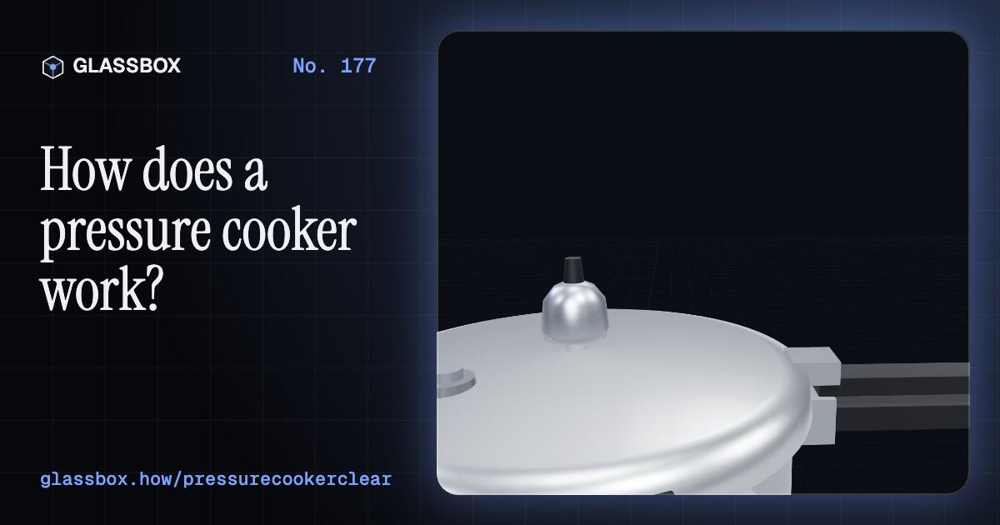
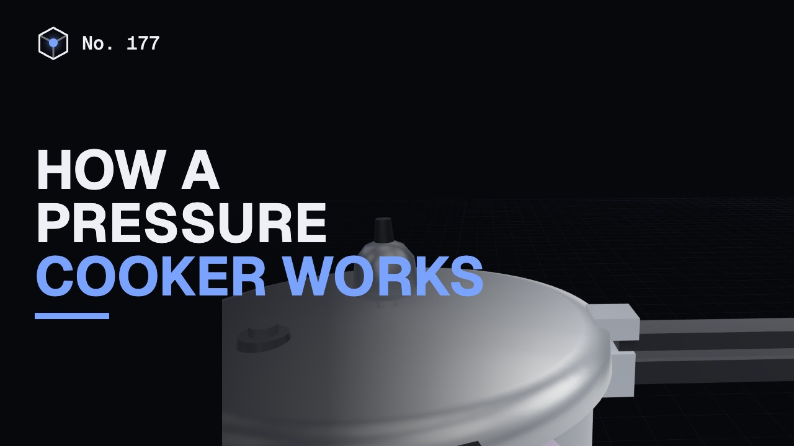
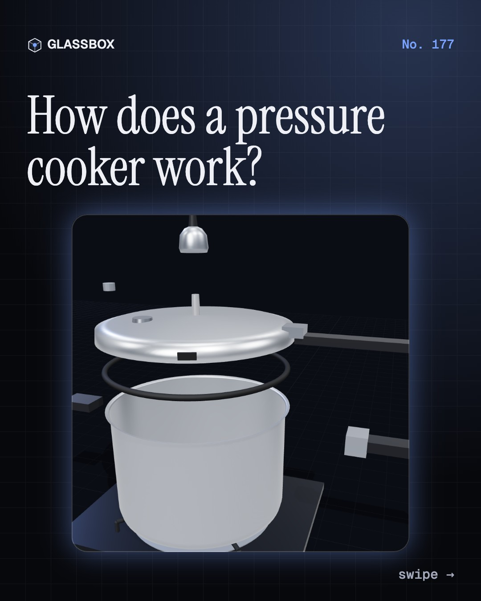
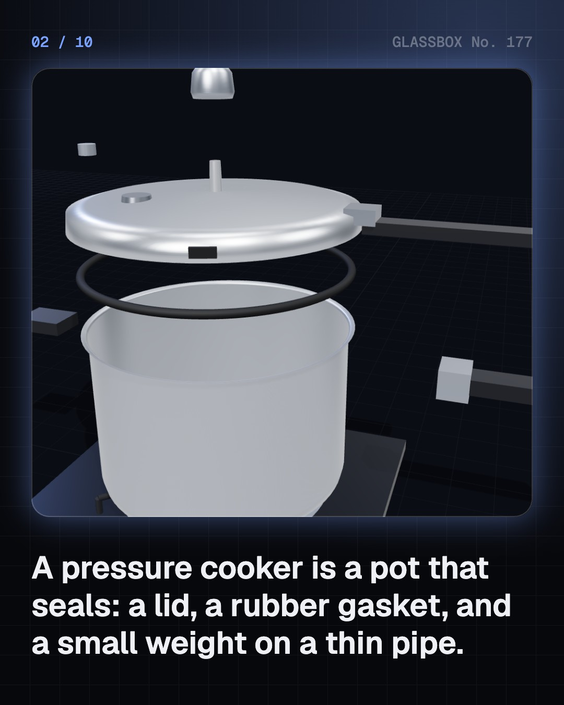
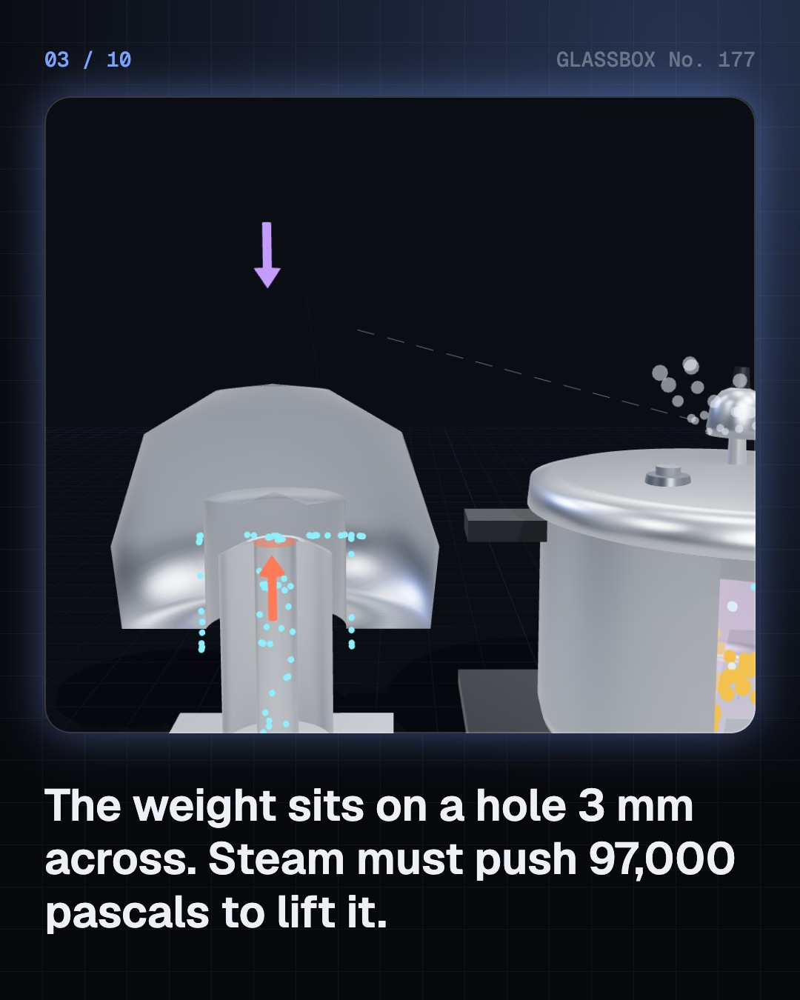
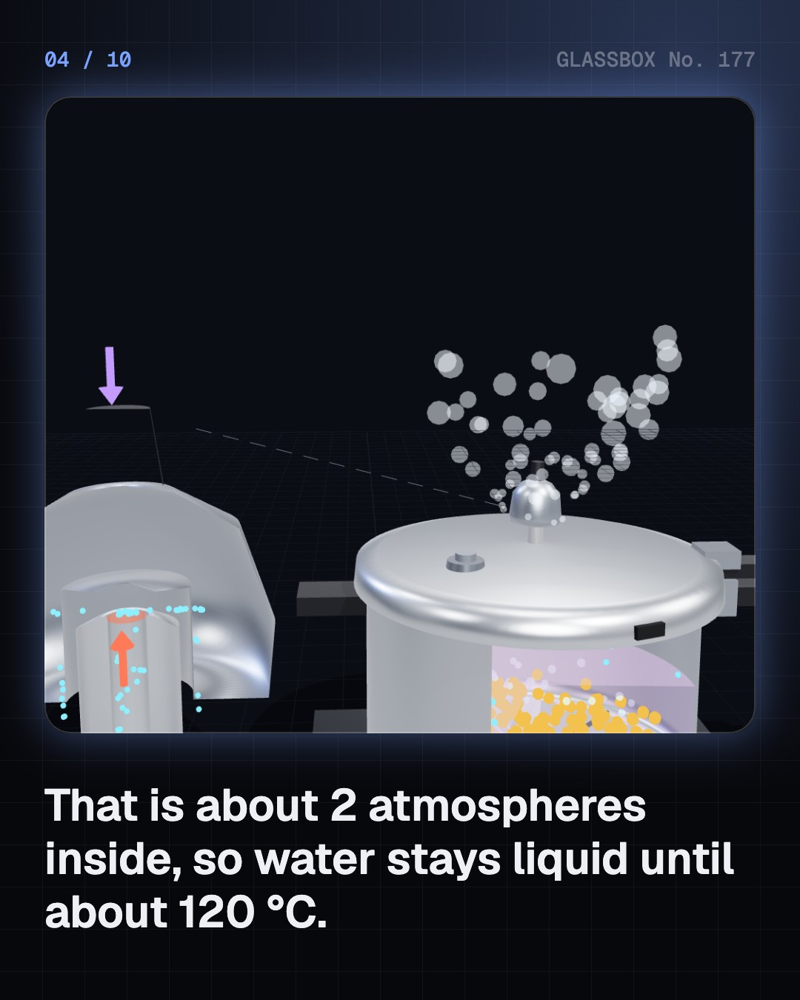

<!-- glassbox:start -->
<!-- Generated from glassbox.json by the Glassbox hub (npm run readme -- pressurecookerclear). Edit glassbox.json, not this block. -->
<p align="center"><a href="https://glassbox.how/e/pressurecookerclear/"></a></p>

<h1 align="center">PressureCookerClear</h1>

<p align="center"><b>How does a pressure cooker work?</b><br>A 70-gram weight on a hole 3 mm across holds back steam pushing like 380 kg on the lid. Take an Indian whistle cooker apart in 3D, count its whistles, and see why 120 °C cooks dal four times faster.</p>

<p align="center"><a href="https://glassbox.how/pressurecookerclear/"><b>▶ Play with it</b></a> &nbsp;·&nbsp; <a href="https://glassbox.how/e/pressurecookerclear/">Read the 60-second explainer</a> &nbsp;·&nbsp; <a href="https://glassbox.how/pressurecookerclear/glassbox/reel.mp4">Watch the 40-second video</a></p>

<p align="center">
  <a href="https://glassbox.how/e/pressurecookerclear/"></a>
  <a href="https://glassbox.how/e/pressurecookerclear/"></a>
  <a href="LICENSE"></a>
  <a href="LICENSE-CONTENT.md"></a>
  <a href="#privacy"></a>
</p>

## In 60 seconds

1. **A pot that seals.** A pressure cooker is a strong pot whose lid seals with a rubber gasket. On the lid stands a thin vent pipe with a loose weight, the whistle, on top. A safety valve, usually a fusible plug in Indian cookers, and a lid that locks under pressure are the backups.
2. **The weight sets the pressure.** Steam can only escape by lifting the weight, so it lifts when pressure × the hole's area equals the weight's force. A 70 g weight on a 3 mm hole gives about 97 kPa, close to the 1 kgf/cm² Indian cookers are built for. Inside it is about 2 atmospheres, so water boils at about 120 °C.
3. **Why it whistles again and again.** When the weight lifts, steam rushes out at about 2 g a second and carries heat away faster than the flame adds it. The pressure falls, the weight drops back, and the flame builds it up again. The time between whistles depends on the flame and on how much food is inside.
4. **Hotter means much faster.** Wet food cannot get hotter than the water's boiling point. Cooking is chemistry, and with dal's activation energy the Arrhenius equation says 120 °C cooks about four times faster than 100 °C. In Leh, where an open pot boils at 88 °C, the difference is even bigger.
5. **Layers of safety.** If froth blocks the vent, the pressure climbs until the fusible plug gives way, which India's standard IS 2347 says must happen before 3 kgf/cm². The lid cannot be opened while there is pressure. These parts must never be blocked, weighted or changed; let the pressure fall by itself before opening.
6. **From Papin to the multicooker.** Denis Papin showed a steam digester with a weighted safety valve in 1679. Autoclaves sterilise at 121 °C with the same pressure. Indian makers began in 1959, the ISI mark became compulsory in 2021, and electric multicookers now use sensors instead of a whistle.

## Words worth knowing

| Term | Meaning |
|---|---|
| **Pressure** | Force spread over an area, P = F ÷ A, measured in pascals. |
| **Gauge pressure** | Pressure above the outside air. A cooker runs at about 1 kgf/cm², about 100 kPa, gauge. |
| **Boiling point** | The temperature where water's vapour pressure equals the pressure around it: 100 °C at sea level, about 120 °C in a cooker. |
| **Weight valve** | The loose weight on the vent pipe. Its weight over the hole's area sets the cooker's pressure. |
| **Gasket** | The rubber or silicone ring that seals the lid to the body. |
| **Fusible plug** | A safety plug of metal that gives way if the pressure or temperature gets far too high. |
| **Arrhenius equation** | How a reaction's speed rises with temperature: k = A e^(−Ea ÷ RT). |
| **Natural release** | Switching off the heat and letting the pressure fall by itself before opening the lid. |

## A short history

**From a scientist's bone digester in 1679 to the whistle in every Indian kitchen.**

- **1679** · A pot that cooks above boiling (Denis Papin, London, England)
- **1679** · A weight on a lever: the safety valve (Denis Papin, London, England)
- **1879** · The autoclave sterilises with steam (Charles Chamberland, Paris, France)
- **1938** · A rubber safety plug (Alfred Vischer, New York, USA)
- **1939** · The saucepan cooker (National Pressure Cooker Company, New York, USA)
- **1959** · Pressure cookers made in India (TT Private Ltd (now TTK Prestige), India)
- **1959** · Pressure Cookers and Appliances Ltd (H. D. Vasudeva, India)
- **1991** · The electric pressure cooker (Yong-Guang Wang (attributed), China)

The full story, with 25 moments, charts, people and 27 sources: [glassbox.how/e/pressurecookerclear/history](https://glassbox.how/e/pressurecookerclear/history/). The data lives in [`history.json`](history.json).

## Video and slides

Made with the Glassbox studio from this box's storyboard (`window.glassbox.director`). Free to reuse under CC BY 4.0.

<a href="https://glassbox.how/pressurecookerclear/glassbox/video.mp4"></a>

<p><a href="glassbox/slide-1.jpg"></a> <a href="glassbox/slide-2.jpg"></a> <a href="glassbox/slide-3.jpg"></a> <a href="glassbox/slide-4.jpg"></a></p>

| File | What | Size |
|---|---|---|
| [`glassbox/reel.mp4`](https://glassbox.how/pressurecookerclear/glassbox/reel.mp4) | Reel / Short, with captions and soundtrack | 1080×1920 |
| [`glassbox/video.mp4`](https://glassbox.how/pressurecookerclear/glassbox/video.mp4) | YouTube video, with captions and soundtrack | 1920×1080 |
| `glassbox/slide-1…10.jpg` | Instagram carousel | 1080×1350 |
| `glassbox/thumb.jpg` | YouTube thumbnail | 1280×720 |
| `glassbox/cover.jpg` | Share card and repo social preview | 1200×630 |
| [`glassbox/history-reel.mp4`](https://glassbox.how/pressurecookerclear/glassbox/history-reel.mp4) | “History in 10 moments” Reel / Short | 1080×1920 |
| `glassbox/history-slide-*.jpg` | History carousel | 1080×1350 |
| `glassbox/post.json` | Post copy and schedule used by the publish kit | |

## Privacy

This box has no accounts and no ads, and it ships its own fonts and libraries. When you run it yourself it sends nothing anywhere. On glassbox.how, the site's `/bar.js` also loads Glassbox's analytics: **Google Analytics** to count visits (it asks first in the EU, UK and Switzerland, and stays off when your browser sends Global Privacy Control or Do Not Track) and **ClickTrust** to detect bots.

It remembers a few things **in your own browser only**, and never sends them anywhere:

| Browser storage key | What it holds |
|---|---|
| `pressurecookerclear.v1` | Which chapters you have opened, your best quiz scores, and sound on or off. |

Exactly what each one sees is at [glassbox.how/privacy](https://glassbox.how/privacy/).

## Licences

- **Code:** [MIT](LICENSE). Use it, change it, ship it.
- **Explanations, text, images and videos** (`glassbox.json`, `glassbox/`): [CC BY 4.0](LICENSE-CONTENT.md). Credit “Glassbox, glassbox.how/e/pressurecookerclear”.
- **Third-party parts** keep their own licences: [three.js](https://threejs.org) (MIT), [Geist, Instrument Serif](https://openfontlicense.org) (SIL OFL 1.1).
- The Glassbox name and logo aren't covered by either licence. See the [terms](https://glassbox.how/terms/).

Found a mistake? [Open an issue](https://github.com/bdeeps/pressurecookerclear/issues). Corrections happen in public.
<!-- glassbox:end -->

## Run it

It's plain HTML, CSS and JavaScript. No build step and no dependencies. Run locally, it contacts no other website.

```bash
python3 -m http.server 8000
```

Three.js and the fonts ship in `vendor/` and `fonts/`, so it also works offline.

Then open http://localhost:8000.

## How it's built

| File | What |
|---|---|
| `index.html`, `css/app.css` | The page and its styles |
| `js/app.js`, `js/stage.js`, `js/ui.js`, `js/kit.js` | The shared Glassbox 3D engine: chapters, 3D stage, controls, quiz, video director |
| `js/cooker.js` | Shared physics and models: steam tables, the weight valve (P = m g ÷ A), the whistle cycle, Arrhenius cooking rates, chart boards and a generic stovetop cooker |
| `js/chapters/*.js` | One file per chapter: the 3D model, controls, text, key terms, quiz and video scenes |
| `glassbox.json` | Title, question, explainer beats, key terms, browser storage and credits shown on glassbox.how |
| `reel` in each chapter | The storyboard the Glassbox studio records into short videos |
| `glassbox/` | The published video, slides, thumbnail and post copy |
| `fonts/`, `vendor/three/` | Self-hosted Geist and Instrument Serif (SIL OFL 1.1) and three.js (MIT) |
